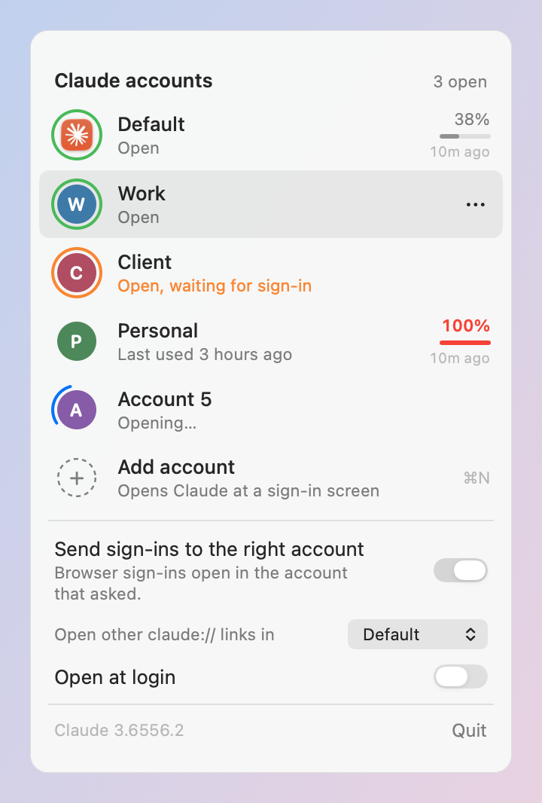
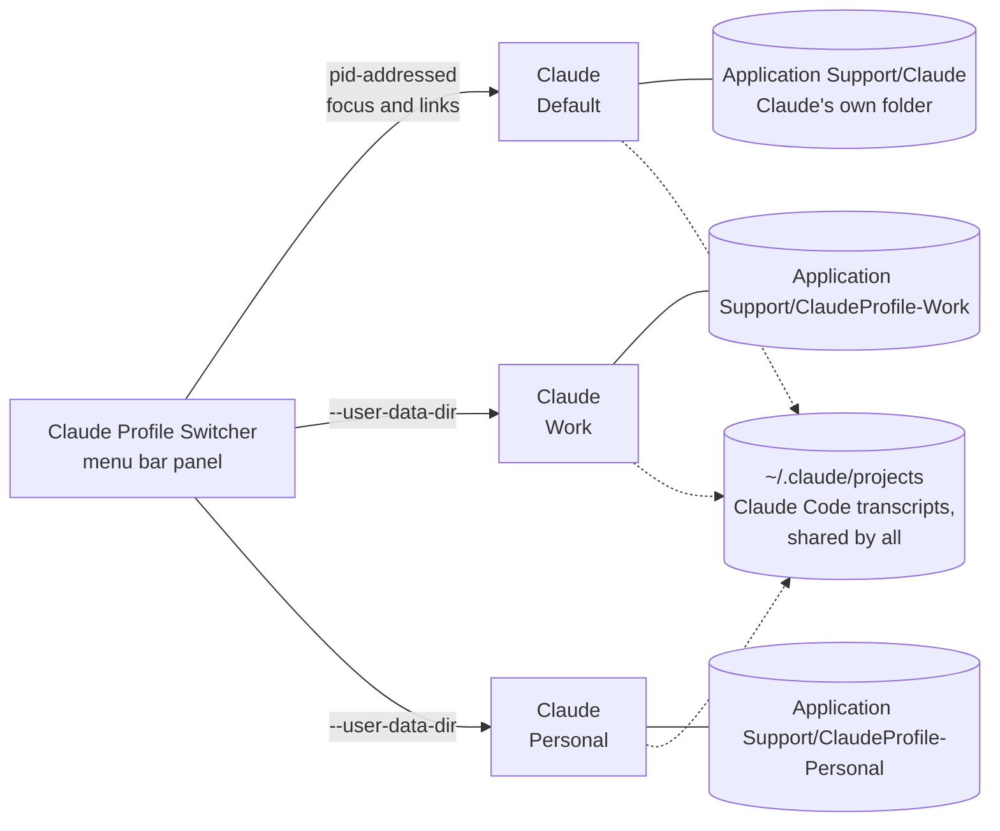

<p align="center">
  
</p>

<h1 align="center">Claude Profile Switcher</h1>

<p align="center">
  <b>Several Claude desktop accounts side by side on one Mac, one click away in the menu bar.</b><br>
  No signing out, no second user account, no patched app.
</p>

<p align="center">
  <a href="https://github.com/onlyilkr/claude-profile-switcher/actions/workflows/ci.yml"></a>
  <a href="https://github.com/onlyilkr/claude-profile-switcher/releases"></a>
  
  
  <a href="LICENSE"></a>
</p>

> [!IMPORTANT]
> **Unofficial community tool. Not affiliated with or endorsed by Anthropic.** It starts the Claude
> app you already have with Electron's documented `--user-data-dir` switch and never modifies it.
> Using several accounts is subject to Anthropic's terms.

<p align="center">
  <picture>
    <source media="(prefers-color-scheme: dark)" srcset="docs/images/panel-dark.png">
    
  </picture>
</p>

## Contents

- [Why](#why)
- [How it works](#how-it-works)
- [Features](#features)
- [Install](#install)
- [Quick start](#quick-start)
- [The panel](#the-panel)
- [Usage limits](#usage-limits)
- [Signing in from the browser](#signing-in-from-the-browser)
- [Moving Claude Code chats between accounts](#moving-claude-code-chats-between-accounts)
- [Shared chats](#shared-chats)
- [Launchers](#launchers)
- [Command line](#command-line)
- [Configuration](#configuration)
- [Where things live](#where-things-live)
- [Safety and privacy](#safety-and-privacy)
- [Limitations](#limitations)
- [Troubleshooting](#troubleshooting)
- [Uninstall](#uninstall)
- [Development](#development)
- [Credits](#credits)

## Why

The Claude desktop app holds one account at a time. If you use a personal account and a Team or
Enterprise one, or work for several organisations, switching means signing out, signing in, and
losing the other account's open windows, Code tab and Cowork state every time.

Claude Profile Switcher keeps each account in its own Claude window, all signed in at once, and puts
them in a panel next to the clock. Your existing Claude keeps working exactly as before; the others
appear beside it.

## How it works

Claude is an Electron app, and Electron keeps everything that makes up a login (cookies, local
storage, `config.json`) in one data folder, which `--user-data-dir` can point elsewhere. Each extra
account is simply its own folder, and Claude started on it is a separate, fully independent copy.



Three things about Claude on macOS shape the design (as observed with Claude Desktop 3.6556):

1. **Claude takes no single instance lock on macOS.** It relies on Launch Services, which does not know
   about data folders. Two copies on one folder would both start and corrupt it, so before every launch
   the switcher reads each Claude process's real arguments (`sysctl KERN_PROCARGS2`) and brings an
   already open account forward instead of starting it again.
2. **Every copy has the same bundle id.** Anything addressed to "Claude" by name could reach any of
   them, so the switcher talks to one copy at a time by its process id.
3. **Links arrive as Apple Events.** Claude reads `claude://` links from `open-url`, not from its
   arguments, so a link for an open account is sent to that copy's pid as a `GURL` event.

## Features

| | |
| --- | --- |
| **One click per account** | Open an account, or bring it forward if it is already open. Never a second copy on one profile. |
| **Status at a glance** | A ring around each badge: green open, orange open and waiting for a sign-in, spinning while it starts. |
| **Usage limits** | Each account's 5-hour limit as Claude last measured it, the weekly limit in its tooltip. Read from Claude's own files, no credentials. |
| **Add an account in one click** | A fresh profile opens Claude at its sign-in screen. Sign in and you are done. |
| **Sign-ins land in the right account** | Optional: browser sign-ins (Google, email links) go to the account that asked, not to whichever Claude macOS picks. |
| **Move Claude Code chats** | Copy chats to another account and carry on there, with the rules of [claude-migrate](https://github.com/onlyilkr/claude-migrate). Pins come along, in order. |
| **Shared chats** | See which chats exist in several accounts and whether one copy is behind. Optional and experimental: keep worktree chats linked so both accounts continue one history. |
| **Launchers** | `Claude - Work.app` in `~/Applications` with a coloured badge, for Spotlight, Launchpad and the Dock. |
| **Per-account environment** | Environment variables and launch flags for one account's Claude, for example for an MCP server. |
| **Your original stays put** | The account you already have keeps its folder, auto update and settings. The switcher only writes there when you transfer chats into it. |
| **Native and small** | Swift and AppKit, one universal binary, no dependencies, no network access, English and Turkish. |

## Install

Requires macOS 13 Ventura or later and the [Claude desktop app](https://claude.ai/download).

### Homebrew

```sh
brew install --cask onlyilkr/tap/claude-profile-switcher
```

This installs the app to `/Applications` and the command line as `claude-profiles`. The app is not
notarized yet, so the cask clears its quarantine flag on install; without that, Gatekeeper would
refuse to open it. If you would rather not have a cask do that, build it yourself (below).

### Release download

Download `Claude-Profile-Switcher-<version>.zip` from the
[releases page](https://github.com/onlyilkr/claude-profile-switcher/releases), check it against the
published checksums, unzip, and move the app to `/Applications`:

```sh
shasum -a 256 -c checksums.txt   # run next to the downloaded zip
xattr -dr com.apple.quarantine "/Applications/Claude Profile Switcher.app"
```

The second line tells Gatekeeper you trust this download; do it only for a zip whose checksum matched.

### Build from source

Needs Xcode (or a Swift 5.9+ toolchain). Nothing to download besides the repository, and a build you
made yourself needs no Gatekeeper workaround.

```sh
git clone https://github.com/onlyilkr/claude-profile-switcher.git
cd claude-profile-switcher
make install    # builds, copies to ~/Applications, opens it
```

## Quick start

1. Open **Claude Profile Switcher**. Its icon, two circles with a ring around the front one, appears
   next to the clock; click it.
2. Your existing Claude is listed as **Default**. Click **Add account**: a new Claude window opens at
   the sign-in screen.
3. Sign in with your other account. Both stay signed in from now on.
4. Hover the new row, click **⋯**, then **Rename** to call it something like `Work`.
5. The first time there are two accounts, the panel offers to send browser sign-ins to the right
   account. Turn it on if you sign in with Google or email links (see
   [below](#signing-in-from-the-browser)).
6. Optional: turn on **Open at login**, and add launchers for the accounts you use most.

> [!TIP]
> The first time the switcher brings an open account forward or hands it a link, macOS asks whether
> it may control Claude. Click **OK**: that is how it reaches one specific Claude window among several.

## The panel

| Element | Meaning |
| --- | --- |
| Green ring | The account's Claude is open and signed in. Click to bring it forward. |
| Orange ring, "waiting for sign-in" | Open, but not signed in yet. |
| Spinning ring, "Opening…" | Started from the switcher, not up yet. Clicking again does not start a second copy. |
| No ring, "Last used …" | Closed. Click to open it. |
| `38%`, a thin bar and `12m ago` | The 5-hour limit as Claude last measured it, and how long ago. Orange from 75 %, red from 90 %. Hover for the weekly limit. |
| **⋯** (on hover) or right-click | Open, Open usage in Claude, Rename, Transfer Code chats, Add launcher to Applications, Show in Finder, Move to Trash. |
| Add account | A new profile, opened at the sign-in screen. |
| Send sign-ins to the right account | Sign-in routing on or off. Hidden until there is a second account. |
| Open other claude:// links in | Where links that are not sign-ins go while routing is on. |

Renaming and deleting happen in the row itself: type the new name and press Return, or confirm the move
to the Trash. An account whose Claude is open cannot be deleted.

| Key | Does |
| --- | --- |
| <kbd>↑</kbd> <kbd>↓</kbd> | Move the highlight |
| <kbd>Return</kbd> | Open the highlighted account, or add one |
| <kbd>⌘</kbd><kbd>N</kbd> | Add account |
| <kbd>Esc</kbd> | Cancel a rename or delete, or close the panel |
| <kbd>⌘</kbd><kbd>Q</kbd> | Quit the switcher (your Claude windows stay open) |

## Usage limits

Claude measures its own plan usage while it runs and keeps a 30-day history in each profile,
`plan-usage-history.json`. The switcher reads the newest measurement of every account and shows the
5-hour limit in the row and the weekly limit in the row's tooltip.

- **No credentials.** Nothing is fetched from Anthropic and no token or cookie is read; the numbers
  are the ones Claude itself saved.
- **As fresh as that account's Claude.** Claude measures every few minutes while it is running and you
  are at the computer, but it pauses when its own menu bar icon has not been opened for a while
  (a day, at the time of writing; Anthropic sets the limit). Right-clicking Claude's icon in the menu
  bar measures at once and starts it again; each open account has its own Claude icon there. A
  measurement older than 5 hours says nothing about the current window, so an open account then shows
  **–%** with the age of its last measurement, and a note at the top of the panel says what to do. A
  closed account's meter disappears instead.
- **No reset times.** Claude does not save when a window resets, so neither can the switcher. Claude's
  own **Settings > Usage** has them.
- **Live numbers on demand.** There is no refresh button, because the panel already re-reads every
  second and a half; only Claude can take a new measurement. **⋯ > Open usage in Claude** opens that
  account's **Settings > Usage** in its own Claude window, with live numbers and reset times.

Showing live numbers for closed accounts would mean reading each account's sign-in cookies and calling
claude.ai on its behalf. The switcher deliberately does not do that.

## Signing in from the browser

Claude usually signs in inside its own window, which works with any number of accounts. Some sign-ins
finish in your browser instead, with a `claude://` link: Google sign-in when Claude owns those links,
and links from sign-in emails. macOS hands every such link to one Claude, often not the account that
asked.

With **Send sign-ins to the right account** on, the switcher becomes the app that opens `claude://`
links and passes each sign-in to the first of these that applies:

1. the account you opened while it was signed out (for 15 minutes),
2. the only open account that is signed out,
3. the open account whose window you used last,
4. otherwise **Default**.

Links that are not sign-ins (for example a link to a Code session) go to Default, or to the account
picked under **Open other claude:// links in**. Claude claims `claude://` back every time a copy starts;
while the switcher runs it takes the links back within seconds, so keep it running when routing is on.

Turning routing off gives the links back to Claude. `claude-profiles --status` shows the current state
and `--revert` turns it off from Terminal. The router never logs a link, because a sign-in link carries
a one-time code; its log only says where each sign-in went, and errors are logged as codes, never as
messages that could quote a link. Only links you open from the panel or the command line can mark an
account as waiting for a sign-in; a `claudeprofileswitcher://` link from a web page cannot.

## Moving Claude Code chats between accounts

Claude keeps one small record per Code chat in each account's store, and the conversation itself in
`~/.claude/projects`, shared by every account. A chat started in one account can be continued in
another by copying its record. Choose **⋯ > Transfer Code chats…** on the source account, tick chats,
pick the target account.

| Field | In the copy |
| --- | --- |
| `sessionId` and file name | **Kept**, so the chat stays the same chat |
| `bridgeSessionIds` | Emptied: these are the old account's cloud session ids |
| `scheduledTaskId` | Removed: it points at a task of the old account |
| Everything else | Kept, including fields the switcher does not know |
| Pin | If the chat is pinned in the source, it is pinned in the target too, after the target's own pins and in the source's order. Chats that were already in the target keep the pin state you gave them there. |

Safety rules, the same as [claude-migrate](https://github.com/onlyilkr/claude-migrate):

- **Never overwrites.** A copy is written to a temp file and linked into place, which fails if the name
  exists.
- **Never while the target is open.** Claude keeps its chat list and pins in memory and writes them back
  when it quits, which would drop the copies. The switcher offers to quit the target, copy, and open it
  again.
- **Never brings back a chat you deleted** in the target account.
- **Skips chats that are already there**, also when they were resumed under a new id.
- **Marks chats with no transcript on this Mac**; they would open empty.
- **Uses the account the target is signed in to now.** If that account has not opened the Code tab
  yet, the transfer waits rather than fill a store Claude would never show. An account in several
  organisations gets the chats in the organisation it used most recently, and the summary says so.
- The pin list lives in the target's `claude_desktop_config.json`, next to your MCP servers. Only the pin
  list changes, and a dated copy of the file is kept beside it first
  (`claude_desktop_config.json.switcher-backup-<time>`, the newest five). A symlinked file is written
  through the link, so a shared config stays shared.

The chat stays in the source account too. A chat that does not use a git worktree has one history
file under `~/.claude/projects`, so both accounts continue the same history: finish in one account
before picking it up in the other. A chat that runs in a worktree is different. Claude moves it to a
new worktree when you continue it in the other account, and from then on the two accounts keep two
separate histories, unless you link the chat. See [Shared chats](#shared-chats). Commit work in a
chat's worktree before moving it: uncommitted files are not carried to the new one.

If the target account already has the chat, the summary says so, and when that copy is behind it
says how far ("already in 'Work', but 635 messages behind - don't continue it there") instead of just
"already there". With linking off, it also asks you to confirm before you copy a worktree chat; with
linking on, the transfer links the chat instead.

## Shared chats

Once a chat exists in two accounts, the two copies can drift apart. The switcher finds those chats,
shows how each copy compares, and, if you turn it on, can keep worktree chats on one history.

### What you see

- **A note in the panel**, under the account list, when some chats differ between accounts: "N chats
  differ between accounts" with **Show**. The cross (x) hides it until the set of differing chats
  changes.
- **The Shared chats window**, from **Show** or from the transfer summary. It lists every chat that
  exists in more than one account, most recent first, with the title, its folder and one status per
  account:
  - *up to date*
  - *N messages behind*
  - *forked, N messages of its own*: both copies have messages the other lacks
  - *no history*: the record is there but the history file is not on this Mac
  - *same history, but will split when resumed here*: a worktree chat both accounts still share one
    file for. Continuing it in that account will make Claude start a separate copy.
  - *linked, up to date*, *linked, but Claude moved it again*, and *linked, archived only here*
  
  **Open where it's up to date** opens the account that has the newest copy.
- **`claude-profiles --shared-chats`** prints the same list.

Only local Code chats are covered. The switcher counts messages by reading the history files; it never
changes them in this mode, and nothing it reads leaves your Mac.

### Linking worktree chats (experimental, off by default)

Claude moves a worktree chat to a new worktree when you continue it in a second account, and copies
the history there. Linking prevents that: the switcher makes both accounts point at the same worktree
and the same history file, so there is one chat instead of two.

Turn it on with **Keep worktree chats linked across accounts (experimental)** in the panel (it shows
when you have more than one account). It was tried with Claude 4.29; with another version the panel
says so. Nothing is linked until you ask:

| Button | Does |
| --- | --- |
| **Sync** | For a chat that is behind or forked: keep the newer copy (for a fork you pick which), and make the other account use it. The out-of-date history is moved to the switcher's backups, never deleted. The other account's own record of the chat is replaced (after a backup), keeping its archived and starred state; the pin list is not touched. |
| **Link** | For a chat that is still on one history but would split: tell the other account about the worktree so Claude keeps using it. It uses the same operation as Sync: the other account's chat record is replaced after a backup, and if that account had its own history file for the chat, it is moved to the backups. |
| **Link all** | Link every such chat. |
| **Unlink** | Undo the link for one chat. |

With linking on, a transfer of a worktree chat links it right away. If it cannot (for example the
target account has no worktree list yet, because Claude has not made one there), the chat is still
copied and the window says why.

The account that gets the other copy's history must be closed, and no account may be running that
chat. If one is open, the switcher asks **Quit and sync**, then opens it again afterwards.

#### Limits you should know

- **Experimental.** It relies on how Claude 4.29 behaved when tried. A later Claude may behave
  differently. If the switcher sees a linked chat that Claude moved again, it turns linking off and
  says so; it does not unlink anything.
- **Never open a linked chat in two accounts at once.** Both would write to one history file and it
  would branch. In testing, Claude kept an idle chat's process for about 30 minutes, so closing the window is not
  enough: wait, or quit that account. The panel warns when it sees a linked chat running in two
  accounts.
- **Deleting a linked chat in one account deletes its history in both.** There is only one file.
- **Archive in every account together.** If a linked chat is archived in only one account, that
  account's Claude may give the worktree to another chat. The window marks such a chat.
- **It only handles chats it can understand.** If an account's worktree list is missing, unreadable or
  in an unfamiliar format, the switcher leaves it alone and says why. It never creates that file.

#### Undoing it

**Unlink** (one chat), **Remove links** when you turn the setting off, or
`claude-profiles --unlink-chats` (all chats) remove what the switcher added. It keeps a list of what it
wrote in `links.json` in its settings folder and removes an entry only if it is still as the switcher
left it; changed ones are skipped and reported. Open accounts are skipped too.

After unlinking, a chat goes back to the behaviour described above. Undo does not restore a
worktree that an account had before linking: Claude may have reused it in the meantime. It does not
move a history file back from the backups either.

#### Backups

- Before it changes a file of Claude's, the switcher saves a dated copy next to it
  (`<file>.switcher-backup-<time>`, the newest five).
- A history that Sync replaces is moved to
  `~/Library/Application Support/Claude Profile Switcher/backups/transcripts/<time>/<account>/`.
  History files are never deleted by the switcher.

## Launchers

**⋯ > Add launcher to Applications** creates `~/Applications/Claude - <name>.app` with the account's
badge on Claude's icon. Spotlight and Launchpad find it, and it can be kept in the Dock. A launcher asks
the switcher to open its account, so clicking it for an account that is already open brings that
window forward. Renaming an account renames its launcher; deleting the account removes it.

A launcher for **Default** is useful too: when another account is open, opening Claude from Finder or
Spotlight brings that account forward instead of starting your original one.

## Command line

The app's binary is also a command line tool. With Homebrew it is on your path as `claude-profiles`;
otherwise use the binary inside the app:

```sh
alias claude-profiles="/Applications/Claude\ Profile\ Switcher.app/Contents/MacOS/ClaudeProfileSwitcher"
```

| Command | Does |
| --- | --- |
| `claude-profiles --list` | Profiles, which are open (with pid), and their folders |
| `claude-profiles --launch Work` | Open a profile, or bring it forward if it is open |
| `claude-profiles --add-account` | Add an account and open Claude at its sign-in screen |
| `claude-profiles --shortcut Work` | Make the `Claude - Work.app` launcher |
| `claude-profiles --status` | Sign-in routing state, who opens `claude://` now, and which open accounts are signed in |
| `claude-profiles --route-sign-ins` | Turn sign-in routing on |
| `claude-profiles --revert` | Turn it off and give `claude://` back to Claude |
| `claude-profiles --shared-chats` | Chats that exist in several accounts and how each copy compares |
| `claude-profiles --unlink-chats` | Remove every link the switcher made between accounts' worktree chats (open accounts are skipped) |
| `claude-profiles --open-link <url> --account Work` | Open a `claude://` link in a chosen account |
| `claude-profiles --open-links-in Work` | Where links that are not sign-ins go while routing is on; `Default` undoes it |
| `claude-profiles --claude-path <Claude.app>` | Use a Claude installed somewhere unusual (remembered) |
| `claude-profiles --version`, `--help` | |

Profiles are found by folder name or display name, ignoring case. A name that matches nothing is an
error, never a new empty profile.

| Exit code | Meaning |
| --- | --- |
| 0 | OK |
| 1 | Error: Claude not found, no such profile, an invalid link, a launch that failed |
| 2 | Usage error: unknown argument or a missing value |

## Configuration

Settings live in `~/Library/Application Support/Claude Profile Switcher/settings.json`. The panel
writes most of them; two are for hand editing:

```json
{
  "ProfileEnv":  { "Work": { "MY_MCP_TOKEN_FILE": "/Users/me/.work-token" } },
  "ProfileArgs": { "Work": "--enable-logging --v=1", "Personal": ["--lang", "fr-FR"] }
}
```

| Key | Meaning |
| --- | --- |
| `ProfileEnv` | Environment variables for one account's Claude, keyed by the profile's folder name (`--list` shows it in brackets when the display name differs). Names must be letters, digits and `_`, not starting with a digit. |
| `ProfileArgs` | Extra launch flags for one account, as one string or a list. They apply from every place that opens the account. |
| `Labels`, `Colors` | Display names and badge colours, set from the panel. |
| `SignInRouting`, `OpenLinksIn`, `RouterBackup` | Sign-in routing state. |
| `ClaudePath` | Set by `--claude-path`. |
| `LinkWorktreeChats` | `true` when worktree chat linking is on; absent means off. Set from the panel. |

If `settings.json` stops being valid JSON after a hand edit, the switcher stops saving anything and
says so in the panel, instead of replacing the file and losing your other settings.

Environment and flags apply when that account's Claude starts; a copy that is already open keeps what
it started with, so quit it first. A new profile starts without MCP servers, because
`claude_desktop_config.json` belongs to each profile; copy the `mcpServers` you want from
`~/Library/Application Support/Claude/claude_desktop_config.json` into the new profile's file while its
Claude is closed.

## Where things live

| What | Where |
| --- | --- |
| Your original account | `~/Library/Application Support/Claude`, written only by a chat transfer into it |
| Extra accounts | `~/Library/Application Support/ClaudeProfile-<name>` |
| Switcher settings and logs | `~/Library/Application Support/Claude Profile Switcher/` |
| Launchers | `~/Applications/Claude - <name>.app` |
| Claude Code transcripts | `~/.claude/projects`, shared by all accounts |
| Link list and backups of replaced transcripts | `~/Library/Application Support/Claude Profile Switcher/links.json` and `backups/transcripts/` |

A profile's folder name is its permanent id: Claude stores absolute paths inside its data, so
renaming changes only the label.

## Safety and privacy

- **Your original account's folder is left alone.** It is read for signed-in state, last use and usage, and
  written only when you transfer chats into it (new chat records and the pin list), or, with linking turned on, when you press Sync or Link.
- **One copy per profile.** Every launch checks which data folders are open first.
- **Deleting moves to the Trash**, only for folders named `ClaudeProfile-<id>` directly under Application
  Support, and never while that account's Claude is open.
- **Chat transfer is additive** and never runs while the target is open; see above.
- **No tokens or cookies are used.** Signed-in state comes from `config.json`: the signed-in flag, the id
  of the account last signed in, and the length of the token cache, which is never stored, logged or
  sent. Chat records are read to list and copy them. Transcripts are read only to compare the copies of a shared chat (counting messages); their text is never stored, logged or sent.
- **Links are validated**: only `claude://` followed by ordinary URL characters, up to 2048 of them.
  The switcher's own `claudeprofileswitcher://` links can only open an existing profile.
- **No network access**, no analytics, no updater. The only thing that leaves your Mac is what Claude
  itself sends.

See [SECURITY.md](SECURITY.md) for the full list of what the app touches and how to report a problem.

## Limitations

- **The Dock shows every account with the same Claude icon.** macOS gives each copy its own Dock icon
  and <kbd>⌘</kbd><kbd>Tab</kbd> entry but no way to change another app's icon. Tell them apart in the
  panel, or with launchers.
- **Opening Claude from Finder or Spotlight while another account is open** brings that account forward
  instead of starting your original one. Use the panel or a `Claude - Default` launcher.
- Each open account runs a full copy of Claude: budget about one Claude's worth of memory per account.
  An account that runs Cowork tasks locally starts its own virtual machine (about 4 GB of memory while
  it runs, over 10 GB of disk in that profile).
- Shared between copies: Claude's logs in `~/Library/Logs/Claude`, its app preferences, and global
  shortcuts such as quick entry, which only the first copy to start receives. Each copy adds its own
  Claude icon to the menu bar.
- Usage numbers are only as fresh as each account's last measurement, and have no reset times.
- Only the desktop app changes account. The `claude` command line in Terminal keeps its own login; give
  it per-account settings with the `CLAUDE_CONFIG_DIR` environment variable.
- Linked worktree chats are experimental and must not be open in two accounts at once; see [Shared chats](#shared-chats).
- Everything here relies on undocumented Claude behaviour that an update can change. Features stop
  rather than damage data when something looks unfamiliar.

## Troubleshooting

<details>
<summary><b>The icon does not appear in the menu bar</b></summary>

On a MacBook with a notch, icons that do not fit are hidden behind it. Quit a few other menu bar apps,
or hold <kbd>⌘</kbd> and drag the icon further right. Check that the app is running with
`pgrep -fl ClaudeProfileSwitcher`.
</details>

<details>
<summary><b>"Claude Profile Switcher can't be opened" or "Apple could not verify…"</b></summary>

The release app is not notarized. Install with Homebrew, or clear the quarantine flag of a download
whose checksum matched: `xattr -dr com.apple.quarantine "/Applications/Claude Profile Switcher.app"`.
Or build it yourself.
</details>

<details>
<summary><b>Clicking an open account does not bring its window forward</b></summary>

The switcher needs permission to control Claude. Open **System Settings > Privacy & Security >
Automation**, find **Claude Profile Switcher** and turn on **Claude**. After building it yourself again,
macOS may ask once more; that is expected for ad-hoc signed builds.
</details>

<details>
<summary><b>A browser sign-in opened in the wrong account</b></summary>

Turn on **Send sign-ins to the right account** and keep the switcher running. `claude-profiles --status`
should say `on: sign-ins go to the account that asked`. If it says Claude has the handler back, wait a
few seconds or open the panel once. To be sure, open the account you want to sign in to from the panel
just before signing in: an account opened while signed out has priority for 15 minutes.
</details>

<details>
<summary><b>Transferred chats do not show up</b></summary>

The target account must have opened the **Code** tab at least once, so it has a place for chats. If the
target was open during the transfer, the switcher should have offered to quit it; if you copied with
another tool, quit the target with <kbd>⌘</kbd><kbd>Q</kbd> and open it again. A chat marked "no
transcript on this Mac" opens empty.
</details>

<details>
<summary><b>"This session's old worktree was recycled while it was idle…"</b></summary>

Claude runs Code chats in git worktrees and reclaims idle ones. Resuming the chat put it in a new
worktree on the same branch: committed work is there, uncommitted files from the old worktree are not.
Files ignored by git (`.env`, installed dependencies) also need setting up again in the new worktree.
Commit before moving a chat between accounts to avoid this.
</details>

<details>
<summary><b>An account shows –% instead of its usage</b></summary>

Claude has paused measuring that account because its menu bar icon has not been opened for a while.
Right-click Claude's icon in the menu bar (each open account has its own) and the number returns within
seconds. A closed account shows no meter once its last measurement is more than 5 hours old; open it
to measure again.
</details>

<details>
<summary><b>"Could not find the Claude desktop app"</b></summary>

Install Claude from [claude.ai/download](https://claude.ai/download), or point the switcher at it once:
`claude-profiles --claude-path "/path/to/Claude.app"`.
</details>

<details>
<summary><b>A chat is behind in the other account</b></summary>

The two accounts have separate copies of the chat's history, usually because Claude moved it to a new
worktree when it was continued in the second account. Do not continue from the older copy. Open
**Show** in the panel note (or run `claude-profiles --shared-chats`) to see which copy is newest, and
open the chat there. To make both accounts use the newest copy, turn on the experimental linking and
press **Sync**; read [Shared chats](#shared-chats) first.
</details>

## Uninstall

1. In the panel, turn off **Send sign-ins to the right account** (or run `claude-profiles --revert`), so
   `claude://` links go back to Claude. `brew uninstall` does this for you.
2. Optionally move extra accounts to the Trash from the panel, which also removes their launchers.
3. Quit the switcher and remove the app: `brew uninstall --cask claude-profile-switcher`, or drag it to
   the Trash. `brew uninstall --cask --zap claude-profile-switcher` also removes the switcher's settings
   and logs.

Launchers you kept in `~/Applications` (`Claude - <name>.app`, including one for Default) stop working
once the app is gone; drag them to the Trash too. Uninstalling never removes your extra accounts' folders (`~/Library/Application Support/ClaudeProfile-*`),
because they hold signed-in accounts and chats. Delete them yourself if you no longer need them.

## Development

```sh
make check      # unit tests, release build of the app, command line smoke test
make install    # build and install into ~/Applications
make preview    # re-render the panel screenshots in docs/images
```

See [CONTRIBUTING.md](CONTRIBUTING.md) for the code layout, how to test against a real Claude without
touching your accounts, and the macOS and Claude quirks that shaped the code.

## Credits

- [Claude-Code-Desktop-Switcher](https://github.com/PriyanshuGeTRekT/Claude-Code-Desktop-Switcher) by
  Priyanshu, the Windows original this is a port of, including the profile layout, the sign-in routing
  rules and the badge design (with ideas by [Sukarth](https://github.com/Sukarth)).
- [claude-migrate](https://github.com/onlyilkr/claude-migrate), whose rules the chat transfer follows.

## Contributing and security

Contributions are welcome; read [CONTRIBUTING.md](CONTRIBUTING.md) first. Report vulnerabilities
privately as described in [SECURITY.md](SECURITY.md), not in a public issue. Release notes are in
[CHANGELOG.md](CHANGELOG.md).

## License

[MIT](LICENSE)
